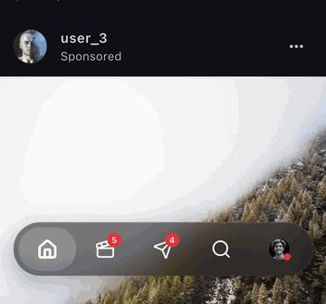
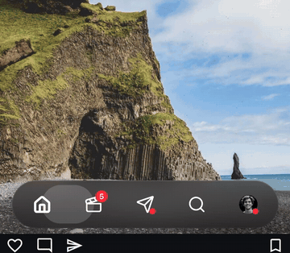

# liquid_glass_floating_tab_bar

An iOS 26 **"Liquid Glass"** floating tab bar for Flutter, like the one in the latest Instagram iOS app.

- **Frosted glass capsule.** It uses a backdrop blur and a translucent tint, and has a 1px gradient edge highlight and a soft shadow that's drawn only outside the glass.
- **Scroll to shrink.** The bar gets shorter and narrower as you scroll down, and grows back when you scroll up. It can snap at a threshold or follow the scroll continuously.
- **Drag between tabs.** Press and drag, and the indicator turns into a larger, clearer glass lens that follows your finger, stretches with speed, and springs to the nearest tab when you let go.
- **Badges and custom tabs.** Tabs can show red dots, counts (`99+`) or short text, and any widget can be a tab, such as a profile picture.
- **Light and dark styles**, `copyWith`, `lerp`, **RTL**, accessibility, and haptics.
- **Pure Dart.** No native code, no dependencies, null-safe, Dart 3.

| Scroll to shrink | Drag the lens |
| :---: | :---: |
|  |  |

<sub>Recorded from the example app in `example/`.</sub>

## Install

```yaml
dependencies:
  liquid_glass_floating_tab_bar: ^0.1.0
```

## Quick start

```dart
import 'package:liquid_glass_floating_tab_bar/liquid_glass_floating_tab_bar.dart';

class Home extends StatefulWidget {
  const Home({super.key});
  @override
  State<Home> createState() => _HomeState();
}

class _HomeState extends State<Home> {
  final _scroll = ScrollController();
  int _index = 0;

  @override
  Widget build(BuildContext context) {
    return Scaffold(
      extendBody: true, // let the content scroll behind the glass
      body: ListView.builder(
        controller: _scroll,
        itemCount: 100,
        itemBuilder: (_, i) => ListTile(title: Text('Item $i')),
      ),
      bottomNavigationBar: LiquidGlassNavBar(
        currentIndex: _index,
        onTap: (i) => setState(() => _index = i),
        scrollController: _scroll,
        items: const [
          LiquidGlassNavItem(icon: Icons.home_outlined, activeIcon: Icons.home, label: 'Home'),
          LiquidGlassNavItem(icon: Icons.search, label: 'Search'),
          LiquidGlassNavItem(icon: Icons.send_outlined, activeIcon: Icons.send, label: 'Messages', badge: NavBadge.count(4)),
          LiquidGlassNavItem(icon: Icons.favorite_border, activeIcon: Icons.favorite, label: 'Activity', badge: NavBadge.dot()),
        ],
      ),
    );
  }
}
```

> Set **`extendBody: true`** on the `Scaffold`. Otherwise the body stops above the bar, and there's nothing behind the glass to blur. With it on, the `Scaffold` adds the bar's height to the body's bottom padding, so the last list item can still scroll clear of the bar.

## Full API

```dart
LiquidGlassNavBar(
  items: [
    LiquidGlassNavItem(
      icon: Icons.home_outlined,
      activeIcon: Icons.home,
      label: 'Home',
      badge: NavBadge.dot(),
    ),
    LiquidGlassNavItem.custom(
      child: CircleAvatar(backgroundImage: NetworkImage(avatarUrl)),
      label: 'Profile',
      badge: NavBadge.dot(position: NavBadgePosition.bottomEnd),
    ),
  ],
  currentIndex: 0,
  onTap: (index) {},          // every tap or drag release, including re-taps
  onTabChanged: (index) {},   // only when the tab actually changes
  scrollController: controller,
  style: LiquidGlassNavStyle(
    blurSigma: 20,
    backgroundColor: Colors.black.withValues(alpha: 0.35),
    borderColor: Colors.white.withValues(alpha: 0.15),
    indicatorColor: Colors.white.withValues(alpha: 0.18),
    dragIndicatorColor: Colors.white.withValues(alpha: 0.10),
    iconColor: Colors.white,
    activeIconColor: Colors.white,
    badgeColor: Colors.red,
    height: 64,
    compactHeight: 52,
    iconSize: 26,
    compactIconSize: 22,
    horizontalMargin: 16,
    compactHorizontalMargin: 48,
    showLabels: false,
    labelStyle: TextStyle(fontSize: 10.5, fontWeight: FontWeight.w600),
    labelBehavior: NavLabelBehavior.always, // always | selectedOnly | never
  ),
  enableShrinkOnScroll: true,
  enableDragToSwitch: true,
  enableHaptics: true,
  shrinkMode: ShrinkMode.threshold,   // or ShrinkMode.continuous
  shrinkThreshold: 10,                // px of scrolling the same way (threshold mode)
  shrinkScrollExtent: 120,            // px from expanded to compact (continuous mode)
  animationDuration: Duration(milliseconds: 250),
  animationCurve: Curves.easeOutCubic,
  spring: LiquidGlassNavBar.defaultSpring,
  selectOnCompactTap: true,
)
```

### Styles

```dart
style: LiquidGlassNavStyle.light()
style: LiquidGlassNavStyle.dark().copyWith(blurSigma: 30, showLabels: true)
style: LiquidGlassNavStyle.lerp(light, dark, t) // animated theme switches
```

If you leave out `style`, the bar picks `.light()` or `.dark()` from `Theme.of(context).brightness`.

<details>
<summary>All style fields</summary>

| Field | Default (dark) | Notes |
| --- | --- | --- |
| `blurSigma` | `20` | Backdrop blur strength |
| `backgroundColor` | `#1C1C1E @ 55%` | Glass tint |
| `borderColor` | `white @ 15%` | Edge highlight, fades toward the bottom |
| `indicatorColor` | `white @ 18%` | Capsule at rest |
| `dragIndicatorColor` | `white @ 10%` | Capsule while dragged (the lens) |
| `lensHighlightColor` | `white @ 55%` | Lens rim and specular highlight |
| `iconColor` / `activeIconColor` | `white` | Also used for labels |
| `badgeColor` / `badgeTextColor` | `#FF3040` / `white` | Defaults for every badge |
| `shadowColor`, `shadowBlurRadius`, `shadowOffset` | `black @ 25%`, `24`, `(0, 8)` | Drawn only outside the glass |
| `height` / `compactHeight` | `64` / `52` | |
| `iconSize` / `compactIconSize` | `26` / `22` | Custom tab children are sized to this too |
| `horizontalMargin` / `compactHorizontalMargin` | `16` / `48` | Gap from the screen edges |
| `bottomMargin` | `8` | Added on top of the bottom safe area |
| `innerPadding` | `6` | Gap between the bar's edge and the indicator |
| `maxWidth` | `520` | Caps the width on tablets. Use `copyWith(clearMaxWidth: true)` to remove it |
| `lensScale` | `1.18` | How much wider the lens gets while dragged |
| `lensOverflow` | `4` | How far the lens sticks out above and below the bar |
| `lensIconScale` | `1.12` | How much the icon under the lens grows |
| `showLabels`, `labelStyle`, `labelBehavior` | `false`, 10.5 w600, `always` | Labels are always hidden while compact |

</details>

### Badges

```dart
NavBadge.dot()                                   // red dot
NavBadge.count(unread)                           // pill with a number; hidden when 0; "99+" above maxCount
NavBadge.text('NEW', color: Colors.blue)
NavBadge.dot(position: NavBadgePosition.bottomEnd) // Instagram-style placement
```

## Scroll to shrink

**One scroll view:** pass its `scrollController`.

**Several scroll views** (for example one per tab in an `IndexedStack`): give the bar a `LiquidGlassNavBarController` and forward scroll notifications from a single listener:

```dart
final navController = LiquidGlassNavBarController();

Scaffold(
  extendBody: true,
  body: NotificationListener<ScrollNotification>(
    onNotification: navController.handleScrollNotification, // never stops the notification bubbling up
    child: IndexedStack(index: index, children: pages),
  ),
  bottomNavigationBar: LiquidGlassNavBar(controller: navController, /* ... */),
);

navController.expand();  // for example after switching tabs
navController.shrink();
navController.isCompact;
```

| Mode | Behavior |
| --- | --- |
| `ShrinkMode.threshold` (default) | After `shrinkThreshold` px of scrolling the same way, the bar animates fully with `animationDuration` and `animationCurve`. Small jitter is ignored. |
| `ShrinkMode.continuous` | The bar follows the scroll over `shrinkScrollExtent` px. When scrolling stops, it settles on whichever state is closer. |

Reaching the top of the list always expands the bar. Overscroll bounce is ignored, so hitting the bottom of an iOS list doesn't make the bar expand. Tapping the compact bar, or starting a drag on it, expands it.

## Drag between tabs

- The lens follows the finger continuously, rubber-bands a little past the first and last tabs, and stretches sideways with drag speed.
- When you let go, it springs to the **nearest** tab (`LiquidGlassNavBar.defaultSpring`, damping ratio about 0.77). The drawn position never swings more than a fifth of a tab past the target.
- With `enableHaptics`, each new tab the finger crosses plays `HapticFeedback.selectionClick()`.
- A tap uses the same spring, plus a small lens "pop".

## Placement

- **`Scaffold.bottomNavigationBar`** with `extendBody: true` (recommended). The bar's box always has the *expanded* height, so the `Scaffold` never lays out again while the bar shrinks.
- **`Stack` overlay:** `Positioned(left: 0, right: 0, bottom: 0, child: LiquidGlassNavBar(...))`. Taps on the empty space around the capsule pass through to the content below.

## Controlled widget

The bar shows `currentIndex`. Update it from `onTap`. If you don't (for example, because a tab needs sign-in first), the indicator springs back to the tab that is still selected.

## Performance

- The `BackdropFilter` sits in its own `RepaintBoundary` and `ClipRRect`.
- The indicator is a `CustomPainter` that repaints from the animation controllers directly, so a moving lens rebuilds no widgets.
- Scrolling in threshold mode triggers at most one 250ms animation, not a rebuild on every scroll frame.

## RTL and accessibility

Under `Directionality(textDirection: TextDirection.rtl)`, the first item sits on the right, and dragging and tapping follow what the user sees. Each tab is a semantic button with its label and a selected state.

## Example

`example/` is an Instagram-style demo. It has five tabs (feed, reels, messages, a search grid, and profile), an avatar tab, badges, and a settings page for theme, RTL, labels, shrink mode, drag, and haptics.

```sh
cd example && flutter run
```

`example/integration_test/demo_test.dart` walks through every behavior on a real device or simulator. It's also the script used to record the GIFs above.

## License

MIT
